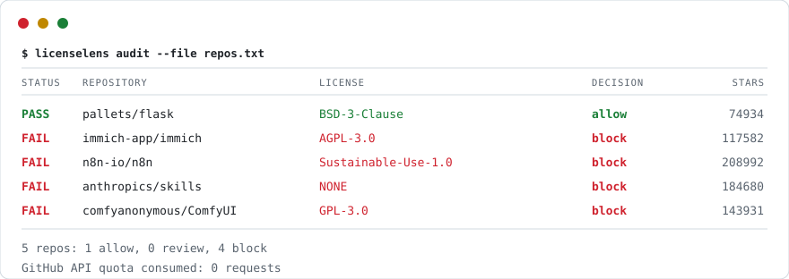

# licenselens

**Find the licenses that will stop you shipping.**

Most license scanners tell you the name of a license. `licenselens` tells you
whether you can ship, and answers correctly on the cases where naive scanners are
wrong: the copyleft license that *mentions* a harsher one, the permissive file
that carries an "All rights reserved" notice, the Creative Commons dataset that
is one word away from being uncommercializable.

No runtime dependencies. No API key. No install required.

<p align="center">
  
</p>

---

## The three failures this tool exists to prevent

### 1. GPL-3.0 misread as AGPL-3.0

Section 13 of GPL-3.0 is literally titled *"Use with the GNU Affero General
Public License"*. Any scanner that greps a license file for "Affero" concludes
AGPL-3.0 — a **network copyleft** license whose obligations are materially
harsher. Teams then either over-comply for no reason or stop trusting the tool.

```
$ licenselens judge GPL-3.0.txt
GNU General Public License v3.0  [GPL-3.0]
  confidence   99%
  copyleft     project
```

`licenselens` scores evidence by **region**. A signal may be a title or a body
mention, and only title evidence can name the license. GPL-3.0's mention of
Affero sits 550 lines into the body, so it carries no promotion weight. AGPL-3.0
scores **0** against a GPL-3.0 file.

### 2. BSD-3-Clause misread as BSD-2-Clause

Clauses 1 and 2 are **identical** in both licenses. Only clause 3 — "Neither the
name of … may be used to endorse" — separates them. Score the shared clauses
highly and BSD-2 wins every time. This is not hypothetical: it happened to
`pallets/flask` on this tool before it was fixed, 145 to 140.

The fix is structural. Per-license scores are split into *total* and
*distinctive* evidence, where distinctive means signals no other profile shares,
and ties break on distinctive evidence:

```
BSD-3-Clause   total=170  distinctive=140   <- wins
BSD-2-Clause   total= 90  distinctive= 60
```

### 3. "No LICENSE file" read as "free to use"

A public repository without a `LICENSE` file is **not** open source. Default
copyright applies: all rights reserved. This is the most common and most
expensive mistake in dependency review, and it is invisible to a scanner that
only reports license *names* — it reports nothing, and nothing reads as fine.

`licenselens` reports it as a **blocking** finding with a remedy, and separates
it from copyleft risk so the two do not get conflated in your ticket queue:

- **license risk** — terms forbid or endanger commercial use → buy, replace, or isolate
- **hygiene risk** — no license, unknown license, dead project → get permission, pin, or vendor

---

## Install

Nothing to install:

```bash
git clone https://github.com/yuehancn/licenselens
cd licenselens
python licenselens.py judge LICENSE
```

Or install it:

```bash
pip install licenselens
licenselens --version
```

Python 3.9+. Zero dependencies.

## Use

### Classify a license file (offline, no network)

```bash
licenselens judge LICENSE
licenselens judge LICENSE --quiet        # just the SPDX id
licenselens judge LICENSE --json         # full evidence trail
licenselens judge LICENSE --policy saas  # evaluate against your deployment model
```

```
== LICENSE
MIT License  [MIT]
  confidence   100%
  commercial   allowed
  copyleft     none
  obligations
    - Attribution only; keep the copyright notice and license text.
  evidence
    MIT               270
    ISC                 0
  decision     allow
  summary      Shippable as-is under the current policy.
```

### Audit repositories (no API quota consumed)

```bash
licenselens audit pallets/flask n8n-io/n8n immich-app/immich
licenselens audit --file repos.txt --format markdown -o audit.md
licenselens audit --file repos.txt --format sarif -o licenses.sarif
```

```
STATUS REPOSITORY                               LICENSE                  DECISION         ★
------------------------------------------------------------------------------------------
OK    pallets/flask                            BSD-3-Clause             allow        74934
FAIL  immich-app/immich                        AGPL-3.0                 block       117582
FAIL  n8n-io/n8n                               Sustainable-Use-1.0      block       208992
FAIL  anthropics/skills                        NONE                     block       184680
------------------------------------------------------------------------------------------
4 repos: 1 allow, 0 review, 3 block

Blocking issues
  anthropics/skills
    [NO-LICENSE] No license file: default copyright applies, so all rights are
    reserved and commercial use is not permitted.
    -> Get written permission from the author, or replace the dependency. Do not
    treat a public repository as free to use.
```

### Audit your own dependency tree (offline, or with registry lookup)

```bash
licenselens scan .                 # offline: reads what your manifests declare
licenselens scan . --resolve       # also look up undeclared licenses in the registry
```

```
STATUS PACKAGE                            LICENSE                    DECISION
----------------------------------------------------------------------------------------
OK    react                              MIT                        allow
OK    express                            MIT                        allow
OK    requests                           Apache-2.0                 allow
OK    django                             BSD-3-Clause               allow
FAIL  demo-service                       AGPL-3.0                   block
```

### Evaluate an SPDX expression

```bash
licenselens expr "MIT OR GPL-3.0" "MIT AND AGPL-3.0"
```

`OR` means you may pick a branch, so the permissive one wins. `AND` means every
branch applies, so the harshest term wins. Getting these backwards is a common
and expensive misreading of `package.json`.

### See the knowledge base

```bash
licenselens facts
```

## Exit codes and CI

`0` when everything is allowed, `1` when something is blocked, `2` on bad input.
Use `--fail-on review` to fail on anything that needs a human, or
`--fail-on never` to report without failing.

### GitHub Actions

```yaml
name: license
on: [push, pull_request]
jobs:
  audit:
    runs-on: ubuntu-latest
    steps:
      - uses: actions/checkout@v4
      - uses: actions/setup-python@v5
        with: { python-version: "3.12" }
      - run: pip install licenselens
      - name: Audit dependencies
        run: licenselens scan . --resolve --fail-on block
      - name: Audit repository (SARIF to the Security tab)
        run: licenselens audit --file repos.txt --format sarif -o licenses.sarif
        continue-on-error: true
      - uses: github/codeql-action/upload-sarif@v3
        with: { sarif_file: licenses.sarif }
```

SARIF findings appear inline on the pull request, so a license problem shows up
where the code review happens instead of in a report nobody opens.

## Why it works on hostile networks

`raw.githubusercontent.com` is blocked or black-holed on plenty of corporate and
regional networks, and GitHub's unauthenticated API allows 60 requests an hour —
about 24 repositories. Two design choices address this:

**Dual channel.** The HTML channel reads repository pages and the license body
embedded in the blob payload. It needs no token, consumes **no API quota**, and
does not touch `raw.githubusercontent.com`. The API channel is used to enrich
metadata. Both are available; the HTML channel is the default for bulk work.

**Circuit breaker.** A black-holed host does not fail fast — it hangs until the
socket times out. Retrying a filename list against it turns a 24-repo audit into
an hour of silence, which is the failure mode that makes people abandon a tool.
After two consecutive transport failures the host is tripped and further requests
return instantly, so the caller degrades to the other channel in microseconds.

One real 5-repository audit: **20 requests, 0 breaker trips, 0 API quota used.**

> A note on scraping: GitHub's markup is not a contract. The license body moved
> from a `<textarea>` to a `"rawLines":[...]` React payload, and the star counter
> id changed, both within the last year. Both shapes are supported, and a parse
> failure degrades to the API channel rather than reporting "no license" — the
> specific failure that would silently block every dependency.

## Policy, not just facts

A license name is not a decision. `--policy` selects the commercial posture:

| policy | weak copyleft (MPL/LGPL) | strong copyleft (GPL) | network copyleft (AGPL) |
| --- | --- | --- | --- |
| `commercial` *(default)* | allow | block | block |
| `permissive` | block | block | block |
| `saas` | allow | allow | block |
| `copyleft` | allow | allow | allow |

`saas` is the one worth understanding: GPL is fine when you never distribute the
binary, but AGPL closes exactly that loophole. That distinction decides whether a
dependency is a legal problem or not.

## What it does not do

- **It is not legal advice.** It is a well-tested reading of license text. Have a
  lawyer review anything that blocks a release you care about.
- **It does not resolve full transitive trees.** It reads declared dependencies
  and can look them up in a registry; it does not build a complete SBOM from a
  lockfile across every ecosystem.
- **It does not detect license *violations* in your code**, only the terms of
  dependencies you name.
- **It does not cover every license in existence.** 18 families are modelled,
  covering the overwhelming majority of real dependency trees. Anything else comes
  back as `UNRECOGNIZED` with `decisive=False`, on purpose.

## Test suite

```bash
python licenselens.py selftest
```

```
67/67 passed
```

The fixtures are canonical license texts fetched from the GitHub Licenses API and
the SPDX license list, committed verbatim. Every assertion corresponds to a real
misclassification, including the three above. Notable properties under test:

- every canonical license is identified, including the GPL/AGPL and BSD-2/BSD-3 traps
- verdicts are **order-independent** — permuting the profile list changes nothing
  (an `if/elif` chain fails this by construction)
- every profile has a title-region signal, so none can be hijacked by body mentions
- a short CC notice is resolved from family plus modifiers, so `CC-BY-NC-SA-4.0`
  needs no profile of its own
- `MIT OR GPL-3.0` allows; `MIT AND AGPL-3.0` inherits the network clause

## License

Dual-licensed: **AGPL-3.0-or-later** for open use, or a **commercial license**
for closed-source distribution and hosted services.

You do **not** need to buy anything to run this in your own company or CI. See
[`COMMERCIAL.md`](COMMERCIAL.md) for the exact boundary — it is written to be
read in two minutes, and it tells you plainly when the free option is enough.

## Contributing

See [`CONTRIBUTING.md`](CONTRIBUTING.md). The short version: a wrong verdict is
worse than no verdict, so detection changes need a fixture of the real license
text. Reporting a misclassification is the most valuable thing you can send.